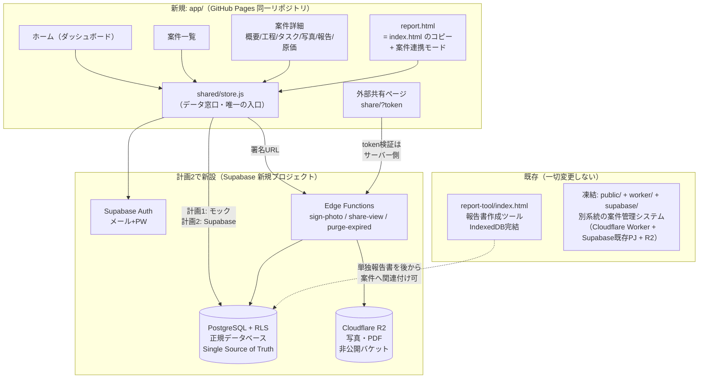
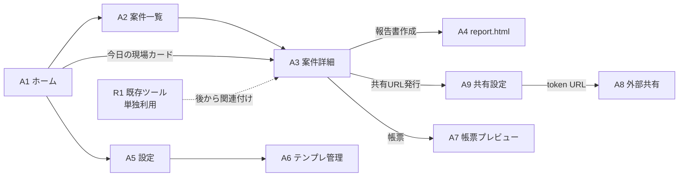
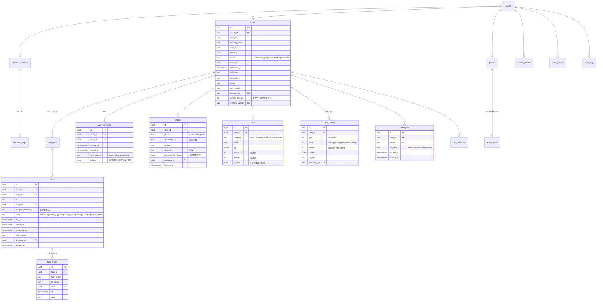

# 現場報告SaaS v2 設計成果物（指示書v1.0 §15対応）

作成日: 2026-10-11
元設計書: `docs/superpowers/specs/2026-10-11-case-management-saas-design.md`（基本アーキテクチャ・コスト試算・PWA方針はそちらが正）
調査結果・再利用方針・リスク一覧: `docs/existing-system-audit.md`

本書は指示書v1.0で追加された要件（工程テンプレート / タスク停滞判定 / 外部共有 / 帳票2種 / データ台帳 / 権限マトリクス）を既存設計に統合した成果物。

---

## 0. 差別化ポイントと設計原則（2026-10-11 承認・最優先）

**北極星: 案件管理者1人で1000現場を回せること。**
設計原則は**例外管理**——順調な現場は人が見ない。人の目に入るのは「停滞・期限超過・承認待ち・AIが答えられなかった質問」だけ。通知・帳票・進捗共有はすべて自動。

| # | 差別化ポイント | 実現機能 | 実装 |
|---|---|---|---|
| ① | 現場担当UIの良さとスピード報告 | 打刻→選択式入力→撮影チェックリスト→送信まで最短動線。既存ツールの操作感を踏襲 | 計画1・2 |
| ② | 報告書PDF＋社内日報の自動生成 | 1回の報告入力から2帳票を自動組立（既存jsPDF再利用） | 計画3 |
| ③ | 「今誰マターで次何か」が常時見える | タスク停滞判定＋Amazon配送追跡風の工程UI（社内＝ダッシュボード／社外＝共有ページ） | 計画1・4 |
| ④ | 原価管理＋見積書作成 | 打刻×単価の自動原価、材料マスタ×掛率で見積自動組立→PDF→送付・承認管理 | 計画3 |
| ⑤ | 関係者への自動連絡（メール先行） | 入場打刻→「作業開始しました（◯時◯分）」自動送信、前日に注意事項を自動送付。データ設計はメール/LINE両対応、LINE Messaging API連携は後続計画 | 計画4 |
| ⑥ | AI質問対応 | 共有ページの質問欄。所要時間・荷物移動・工事箇所・音・電気水道ガス・制限等へ、案件の公開情報＋会社FAQのみで自動回答。不明時は管理者へエスカレーション | 計画5 |

承認済み方針: DB＝新規Supabase独立 ／ UI先行 ／ 白基調Stripe風 ／ 連絡はメール先行。

## 1. 新旧システム構成図（成果物2）

- 画面は `store.js` 経由でのみデータに触れる（画面ごとの別保存先を禁止＝指示書§8）。
- 外部共有の権限判定・非公開項目の除去は Edge Function（サーバー側）で実施。クライアントに高権限キーは置かない（指示書§9・§12）。

## 2. 画面一覧・画面遷移図（成果物3）

| ID | 画面 | 利用者 | 実装時期 |
|----|------|--------|---------|
| R1 | 報告書作成ツール（既存・無変更） | 現場担当 | 稼働中 |
| A1 | ホーム＝管理ダッシュボード（**例外ファースト**: 停滞・期限超過・承認待ち・要回答の質問だけが浮上 → その下に今日の現場） | 管理者・現場担当（表示縮退） | 計画1 |
| A2 | 案件一覧（検索・状態チップ・期限アラート） | 管理者・現場担当 | 計画1 |
| A3 | 案件詳細（タブ: 概要 / タスク / 写真 / 報告 / 連絡 / 原価・見積※原価は権限者のみ） | 管理者・現場担当（原価タブ非表示） | 計画1 |
| A4 | report.html（既存コピー＋案件連携モード＋選択式入力＋撮影チェックリスト） | 現場担当 | 計画1（連携は計画2） |
| A5 | 設定（ロール切替プレビュー・標準単価・モック初期化） | 管理者 | 計画1 |
| A6 | 工程テンプレート管理（一覧・複製・版管理） | 管理者 | 計画3 |
| A7 | 帳票プレビュー（社内日報 / クライアント報告書、下書き→承認→公開） | 管理者 | 計画3 |
| A8 | 外部共有ページ（配送追跡風の工程表示＋次アクション＋承認済写真＋**AI質問欄**） | 元請・管理会社・オーナー・入居者 | モック＝計画1 / 本実装＝計画4・5 |
| A9 | 共有設定（案件別公開範囲・URL発行/失効） | 管理者 | 計画4 |

## 3. ER図（成果物4）

指示書§8のエンティティ名 → 採用名の対応:

| 指示書 | 採用名 | 備考 |
|---|---|---|
| organizations | **tenants** | テナント＝契約企業。retention_months / plan / 共有既定値を保持 |
| users | **profiles** | auth.users 1:1。role と原価閲覧権限は別フラグ（指示書§9） |
| projects | **cases** | 案件 |
| project_members | **case_members** | 計画3で追加（計画1〜2は assigned_to で代替） |
| workflow_templates / workflow_steps | 同名 | テンプレは版管理。案件作成時に **case_steps へ複製**（既存案件へ自動反映しない＝指示書§4） |
| tasks / task_events | 同名 | 停滞判定の中核。†下記 |
| work_sessions | 同名 | 作業開始/終了打刻。サーバー時刻と端末暫定時刻を区別 |
| reports / report_entries / report_documents | **case_reports** | type(日報/クライアント)・status(下書き/承認/公開/提出済)・version で1テーブルに統合。entries は content jsonb に内包 |
| attachments | **photos** | 撮影項目・公開承認フラグ付き |
| material_master | 同名 | 材料マスタ |
| labor_rates | **worker_rates** | 原価権限者のみRLSで閲覧可 |
| cost_entries | **costs** | 自動行（打刻×単価）+ 手動行 |
| share_policies / share_links | 同名 | 会社既定 + 案件別例外。会社ロック項目は案件でも開けない |
| audit_logs | 同名 | 通知・承認・変更履歴 |

### 差別化機能の追加エンティティ（指示書外・今回追加）

| エンティティ | 主なフィールド | 用途 |
|---|---|---|
| estimates | case_id, status(draft/sent/accepted/rejected), valid_until, total(整数円), pdf_key, version | 見積書。原価タブから自動組立 |
| estimate_items | estimate_id, label, qty, unit, unit_price, amount, source(material/labor/manual) | 見積明細。材料マスタ×掛率（既定1.3、変更可）で生成 |
| case_contacts | case_id, role_key(motouke/kanri/owner/resident), name, email, line_user_id(将来), notify jsonb(入場通知/前日案内/完了報告のON/OFF) | 案件ごとの関係者台帳＝自動通知とAI応対の宛先 |
| notifications | case_id, contact_id, channel(email/line), template_key(work_started/pre_visit/report_ready/estimate_sent), status(queued/sent/failed), sent_at | 自動通知ログ。入場打刻・前日バッチ等をトリガーに生成 |
| faqs | tenant_id, question, answer, tags | 会社共通FAQ。AI回答の知識源 |
| questions | case_id, contact_id, question_text, ai_answer, escalated(bool), answered_by, answered_at | 共有ページからの質問とAI回答ログ。escalated=true のみダッシュボードに浮上 |

**AIガードレール**: AIに渡すのは**データ台帳で区分＝公のフィールド＋faqsのみ**（Edge Functionで抽出してから渡す）。原価・単価・内部メモは構造的に到達不能。

† **期限超過は保存しない派生状態**: `due_at < now() かつ 未完了` で判定（ビュー/計算層）。保存すると実時刻とずれるため。
† **停滞時間の定義**: 現状態での滞留 = now − 最後の task_events.at ／ 期限超過時間 = now − due_at ／ 保留時間 = task_events の on_hold 区間合計。計算は calc 層に隔離し、将来の営業時間カレンダー注入に対応。

## 4. データ台帳（成果物5・抜粋＝機密区分が要る項目を網羅。全項目版は計画2のマイグレーションと同時に自動生成）

機密区分: **公** = 外部共有可（案件設定に従う）/ **社** = 社内全員 / **密** = 原価閲覧権限者のみ

| 項目 | 型 | 正規取得元 | 更新責任 | 利用先 | 区分 | 帳票出力 |
|---|---|---|---|---|---|---|
| 物件名・号室 | text | cases | 管理者 | 全画面・両帳票 | 公 | 日報/提出用 |
| 住所 | text | cases | 管理者 | 案件詳細・report.html | 公(入居者には号室まで等設定可) | 日報/提出用 |
| 作業予定日・期限 | timestamptz | cases | 管理者 | ホーム・一覧・外部共有 | 公 | 日報/提出用 |
| 注意事項 | text | cases.instructions | 管理者 | 案件詳細・report.html | 社 | 日報のみ |
| 工程・進捗状態 | text | case_steps.status | システム/担当 | ホーム・外部共有 | 公 | 提出用 |
| タスク担当・停滞理由 | text | tasks | 担当者 | ダッシュボード | 社 | 日報のみ |
| 開始・終了打刻 | timestamptz | work_sessions | システム(サーバー時刻) | 原価自動行・日報 | 社 | 日報のみ |
| 写真（全） | R2 key | photos | 現場担当 | 案件詳細 | 社 | 日報 |
| 写真（承認済） | R2 key | photos.approved_for_client | 管理者が承認 | 外部共有・提出用 | 公 | 提出用 |
| 漏水原因・調査結果 | text | cases.cause | 現場担当→管理者確認 | 両帳票 | 公 | 日報/提出用 |
| 今後の対応 | text | cases.next_actions | 管理者 | 外部共有・提出用 | 公 | 日報/提出用 |
| 労務単価 | int | worker_rates | 原価権限者 | 原価計算のみ | 密 | 出力禁止 |
| 材料単価・数量 | int/numeric | material_master, costs | 原価権限者 | 原価タブ | 密(数量は日報に出す場合のみ社) | 日報(数量のみ) |
| 外注費・経費 | int | costs | 原価権限者 | 原価タブ | 密 | 出力禁止 |
| 受注金額（請求額） | int | cases.invoice_amount | 原価権限者 | 原価タブ | 密 | 出力禁止 |
| 粗利益・粗利率 | 計算値 | calc層(costs+invoice) | ― | 原価タブ | 密 | 出力禁止 |
| 内部メモ | text | audit_logs/notes | 各自 | 社内のみ | 社 | 出力禁止 |
| 見積金額・明細 | int | estimates, estimate_items | 管理者 | 見積タブ・提出先への共有 | 公(提出先のみ) | 見積PDF |
| 関係者連絡先 | text | case_contacts | 管理者 | 自動通知・AI応対 | 社 | 出力禁止 |
| 通知ログ | ― | notifications | システム | 連絡タブ | 社 | 出力禁止 |
| 会社FAQ | text | faqs | 管理者 | AI回答の知識源 | 公 | ― |
| 質問・AI回答ログ | text | questions | システム | 連絡タブ・ダッシュボード(要回答のみ) | 社 | 出力禁止 |

**運用則（指示書§8）**: 新機能はこの台帳と store.js（共通サービス層）を必ず経由。台帳にない項目を画面から直接保存しない。

## 5. 権限マトリクス（成果物6）

○=可 / △=案件別設定で可（会社ロックで禁止可） / ×=不可（サーバー側で遮断）

| リソース | 管理者+原価権限 | 管理者 | 現場担当 | 元請 | 管理会社 | オーナー | 入居者 |
|---|---|---|---|---|---|---|---|
| 案件作成・編集 | ○ | ○ | ×(報告のみ) | × | × | × | × |
| 案件基本情報（物件・住所・予定） | ○ | ○ | ○(担当案件) | △ | △ | △ | △(限定) |
| 工程進捗（追跡UI） | ○ | ○ | ○ | △ | △ | △ | △ |
| タスク詳細・停滞状況 | ○ | ○ | ○(自分の分) | × | × | × | × |
| 写真（全） | ○ | ○ | ○(担当案件) | × | × | × | × |
| 写真（承認済のみ） | ○ | ○ | ○ | △ | △ | △ | × |
| 社内日報 | ○ | ○ | ○(自分の分) | × | × | × | × |
| クライアント報告書 | ○ | ○ | △ | △ | △ | △ | × |
| 見積書（提出用） | ○ | ○ | × | △ | △ | △ | × |
| 連絡先台帳・通知設定 | ○ | ○ | × | × | × | × | × |
| AI質問の投稿（共有ページ） | ― | ― | ― | ○ | ○ | ○ | ○ |
| 原価・単価・粗利・請求額 | **○** | **×** | × | × | × | × | × |
| 原価の編集・単価マスタ | ○ | × | × | × | × | × | × |
| テンプレ・共有設定・ユーザー管理 | ○ | ○ | × | × | × | × | × |
| 監査ログ | ○ | ○ | × | × | × | × | × |

- **管理者ロールと原価閲覧権限は分離**（profiles.can_view_cost）。
- 外部4ロールは share_links.role_key + share_policies で判定。**判定と項目除去はサーバー側**（Edge Function がレスポンスから非公開項目を含めずに返す）。
- テナント境界: 全テーブル tenant_id + RLS で強制（別企業のデータは取得不能）。

## 6. 段階的実装計画（成果物8）

| 指示書Phase | 内容 | 対応する実行計画 | 状態 |
|---|---|---|---|
| **Phase 0** | 既存調査・バックアップ・現状テスト | 本成果物 + backupタグ + 本番200確認 | ✅ 完了 |
| **Phase 2・3のUI** | 親画面＋現場UIのプロトタイプ（モックデータ） | **計画1（改訂版）**: `docs/superpowers/plans/2026-10-11-app-ui-prototype-plan.md` ＋改訂v2差分 → ①白基調Stripe風 ②ホームを例外ファースト化 ③タスクに担当/期限/状態/停滞理由 ④report.html に選択式入力・撮影チェックリスト ⑤外部共有ページのモック（追跡UI＋AI質問のルールベース版） ⑥見積・連絡タブのモック | **承認済・着手** |
| **Phase 1** | 正規DB・共通API・認証・権限 | 計画2: Supabase新規PJ + R2 + RLS + Edge Functions + store.js をモック→実DBに差し替え + 打刻のサーバー時刻化 + オフライン再送 + 既存IndexedDB移行 + case_contacts | UIプロト確認後 |
| **Phase 4 ＋差別化②④** | 帳票・見積の自動生成 | 計画3: case_reports（日報/提出用）+ estimates/estimate_items（材料マスタ×掛率）+ 既存jsPDF再利用 + 承認フロー | 計画2後 |
| **Phase 5 ＋差別化⑤** | 外部共有・公開範囲・自動通知 | 計画4: share_policies / share_links / 追跡UI / URL失効 + メール自動通知（入場・前日・完了・見積送付）＋通知ログ | 計画3後 |
| **差別化⑥** | AI質問対応 | 計画5: Edge Function + Claude API。公開フィールド＋FAQのみ参照・エスカレーション運用 | 計画4後 |
| **Phase 6** | 原価確定・停滞アラート・統合テスト | 計画6: 指示書§13の14項目＋差別化機能を一括回帰（LINE Messaging API連携はこの後のオプション計画） | 最終 |

**UI先行の理由（指示書Phase1→2の順と異なる点）**: ①本人方針「実際の操作画面を見ながら修正」 ②全画面が store.js 窓口しか知らないため、DB差し替えでUIに手戻りが出ない ③指示書§14「最初からすべてを一度に書き換えない」と整合。

**毎計画共通の回帰テスト**: `git diff origin/main -- index.html` が空であること（既存ツール無変更の機械的証明）+ 既存URLでPDF出力までの手動スモーク。

## 7. テスト割付（指示書§13 → 実行計画）

| テスト | 計画 |
|---|---|
| 既存URLで報告書作成が動く / 既存PDFが壊れていない | 全計画共通（回帰） |
| スマホで入力できる / 選択式の条件分岐 | 計画1 |
| 開始・終了時刻の記録 / 写真の案件関連付け / 通信切断と再送 | 計画2 |
| 状態遷移 / 停滞・期限超過時間の計算 | 計画1（calc層の単体テスト）+ 計画2（実DB） |
| 日報と提出用の情報分離 / 外部から原価取得不可 | 計画3・4（サーバー側テスト） |
| 別企業の案件取得不可 / 公開URL失効 | 計画2・4 |
| 既存データ移行・後方互換 | 計画2 |
| 入場通知メールの自動送信・通知ログ記録 | 計画4 |
| 見積PDF生成・送付ステータス管理 | 計画3 |
| AIが原価・単価・内部メモへ到達できない（ガードレール） | 計画5 |
